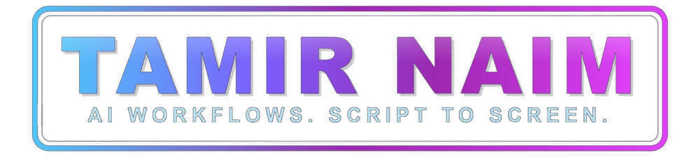
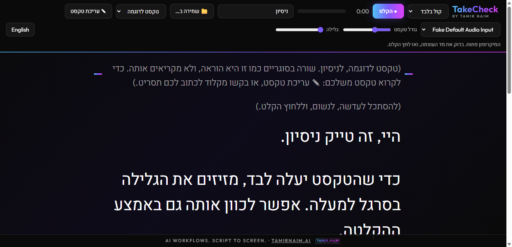

<div dir="rtl">

<p align="center"></p>

# TakeCheck

**פרומפטר לקלוד קוד.**

פרומפטר שמצלם אותך, וקלוד שצופה בטייק.

קוראים את התסריט מהמסך, מקליטים קול או וידאו, ולוחצים עצור. הטייק נשמר לבד במחשב שלך. כשאומרים לקלוד "צילמתי", הוא בודק את הטייק בעצמו. הוא מודד את הסאונד, החדות והאורך, מסתכל בפריימים מהטייק כדי לשפוט מסגור, כיוון מבט ותאורה, ונותן תיקון אחד ברור לכל בעיה. הוא גם אומר אם הצילום מתאים לתאום דיגיטלי, לאווטאר או לכלי סנכרון שפתיים.

נבנה על ידי [תמיר נעים](https://tamirnaim.ai): בינה מלאכותית יוצרת להפקות קולנוע וטלוויזיה.



## מה יש בו

- **פרומפטר:** התסריט שלך, או טקסט שמדביקים. גודל טקסט וגלילה אוטומטית. הוראות במה בתוך סוגריים עגולים מופיעות קטנות ובאפור.
- **בנוי לקשר עין:** התסריט מתחיל ממש מתחת לסרגל העליון, בעמודה צרה לצד תצוגת המצלמה, עם סימון "קוראים כאן". בזמן ההקלטה הסרגל מצטמצם למה שעוד צריך: עצור, שעון, מד עוצמה, גודל טקסט, גלילה וקווי עזר. כך העיניים נשארות קרוב לעדשה.
- **קול או וידאו:** תצוגה חיה מהמצלמה בפינה, שמראה בדיוק את מה שמוקלט. קווי עזר, מסגרת לגודל הפנים שכלי תאום וסנכרון שפתיים צריכים, בדיקת תאורה חיה (חשוך מדי, אור מאחור), ספירה לאחור של שלוש שניות ומד עוצמה. בזמן ההקלטה התצוגה מתכווצת, כדי שלא תמשוך את העיניים.
- **נשמר לבד:** הטייק נכתב לתיקייה מקומית כבר בזמן ההקלטה, כך שקריסה לא מוחקת אותו. טייק וידאו נשמר כקובץ וידאו שעורכים וכלי סנכרון קוראים, הקובץ המקורי, וקובץ קול נפרד. טייק קול נשמר כקובץ קול בלבד.
- **קלוד בודק:** אומרים "צילמתי", וקלוד מודד סאונד, חדות ואורך, מסתכל בפריימים ואומר מה לתקן. מסגור, מבט ותאורה הם שיקול הדעת של קלוד מתוך הפריימים, לא מדידה.
- **קלוד גם כותב את התסריט:** מבקשים מקלוד תסריט, והוא מופיע בפרומפטר לבד.
- **מתקנים את הטקסט ישר בדף:** עורכים כל תסריט בדף, והשינוי נשמר בקובץ התסריט, כך שגם קלוד רואה אותו.
- **תמלול, למי שרוצה:** מתקינים את `faster-whisper`, וכל בדיקה גם מתמללת את הטייק במחשב שלך, בעברית או באנגלית. ככה קלוד רואה מה אמרת מול מה שכתוב בתסריט, על איזו שורה דילגת ואיזו מילה שינית, מה קצב הדיבור האמיתי שלך ואיפה עצרת ארוך. מקבלים גם קובץ כתוביות. בלי ההתקנה הזו, כל השאר עובד אותו דבר. בפעם הראשונה יורד מודל דיבור במשקל של גיגה ומעלה, וכרטיס מסך של `NVIDIA` מאיץ אותו מאוד.
- **ממשק בעברית ובאנגלית,** לפי שפת הדפדפן.

## פרטיות

- רץ רק במחשב שלך. הטייקים נשארים אצלך ולא נשלחים לשום שירות.
- כדי לבדוק טייק, קלוד מסתכל בכמה תמונות סטילס ממנו. התמונות האלה הופכות לחלק מהשיחה עם קלוד, כמו כל תמונה שמשתפים איתו. הווידאו והסאונד עצמם לא נשלחים.
- התמלול נעשה במחשב שלך. קלוד קורא את הטקסט שלו בתוך השיחה.
- תיקיית ההקלטות מוחרגת מגיט, כך שהפנים והקול שלך לא נכנסים לשום מאגר.
- הסקיל מורה לקלוד לא לשלוח טייק לשום שירות בלי אישור מפורש שלך לאותו שירות.
- הפונטים נטענים מגוגל. כל השאר מקומי. מדיניות אבטחה בדף מרשה לו לפנות רק לשרת המקומי ולפונטים של גוגל.

## מה צריך

- **מחשב:** ווינדוס, מק או לינוקס. עד עכשיו נבדק רק על ווינדוס 11.
- **תוכנות:** קלוד קוד, פייתון בגרסה 3.9 ומעלה, ו-`ffmpeg`. לפרומפטר עצמו לא צריך שום התקנה נוספת.
- **דפדפן:** כרום או אדג', שנבדקו. ספארי ופיירפוקס אמורים לעבוד, אבל עוד לא נבדקו.
- **מצלמה ומיקרופון:** כל מצלמה מובנית או חיצונית. טלפון או מצלמת רשת טובה נותנים צילום הרבה יותר טוב ממצלמה רגילה של מחשב נייד.
- **מקום בדיסק:** טייק וידאו באיכות `1080p` תופס כ-200 מגה לדקה בסך הכול: עותק לעריכה, הקובץ המקורי וקובץ הקול. טייק קול תופס כ-9 מגה לדקה.
- **מעבד:** אחרי כל טייק וידאו המחשב ממיר אותו פעם אחת. במחשב חזק טייק של 20 שניות הומר בכ-4 שניות, וכשהוגבל ל-4 ליבות בכ-20 שניות. במחשב נייד רגיל זה ייקח בערך כמו אורך הטייק, או יותר.
- **תמלול, למי שרוצה:** את `faster-whisper`, ועוד כ-1.6 גיגה למודל העברי וכ-3 גיגה למודל הרב-לשוני. כל מודל יורד בפעם הראשונה שמשתמשים בו. כרטיס מסך של `NVIDIA` מריץ אותו מהר. בלעדיו הוא רץ על המעבד, הרבה יותר לאט.

## התקנה

צריך את קלוד קוד, פייתון בגרסה 3.9 ומעלה, ואת `ffmpeg` מותקן. לתמלול צריך גם את `faster-whisper`.

<div dir="ltr">

```
/plugin marketplace add Alejandro1203242/takecheck
/plugin install takecheck@tamir-naim
```

</div>

## שימוש

מבקשים מקלוד, למשל:

> תפעיל את הפרומפטר עם התסריט שלי. אני רוצה לצלם וידאו.

קלוד מפעיל את השרת המקומי ונותן כתובת. פותחים אותה בכרום או באדג', כי הדפדפן שבתוך קלוד חוסם מצלמה. מצלמים, לוחצים עצור, וכותבים לקלוד "צילמתי".

אין עדיין תסריט? הדף נפתח על טקסט דוגמה קצר שמסביר את עצמו תוך כדי קריאה. אפשר להדביק טקסט משלכם בכפתור "✎ עריכת טקסט", או לבקש מקלוד לכתוב תסריט. הכפתור "📁 שמירה ב…" מאפשר לבחור לאיזו תיקייה הטייקים יישמרו.

## על מה זה עובד

- נבדק בווינדוס, בכרום ובאדג'.
- מק ולינוקס: בנוי עבורם, אבל עוד לא נבדק על מחשב אמיתי.
- ספארי מקליט בפורמט אחר, והפרומפטר מטפל גם בו. פיירפוקס אמור לעבוד, אבל עוד לא נבדק.

## רישיון

רישיון `MIT`. ראו את הקובץ `LICENSE`.

</div>
