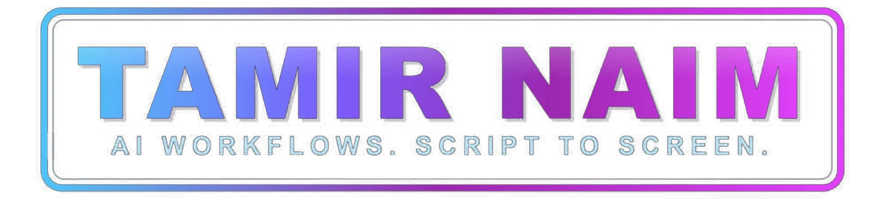
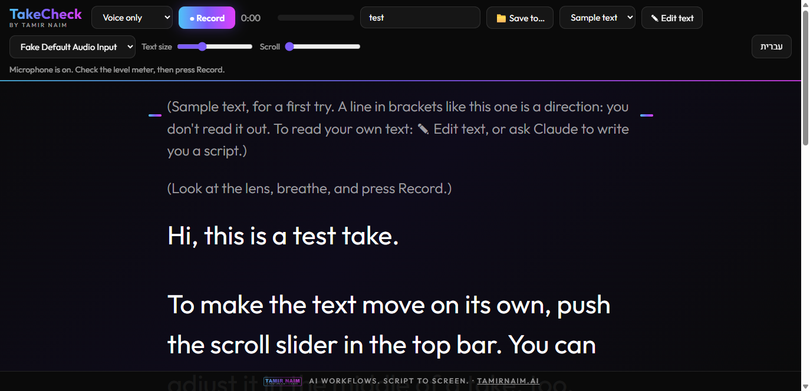

<p align="center"></p>

# TakeCheck

**A prompter for Claude Code.**

A teleprompter that records you, and a Claude that watches the take.

Read your script from the screen, record voice or video, press Stop. The take saves itself on your
computer, and when you tell Claude "done" it reviews it for you. It measures the sound, the sharpness and the
length, looks at frames from the take to judge framing, eye line and light, and gives one concrete fix for each problem. It also tells you whether the footage is usable for a digital
twin, an avatar or a lip-sync tool.

Built by [Tamir Naim](https://tamirnaim.ai): Generative AI for film and TV productions.



## What you get

- **Teleprompter:** your script, or text you paste in. Adjustable size and auto-scroll. Stage directions in
  `(brackets)` show small and grey.
- **Built for eye contact:** the script starts right under the top bar, in a narrow column beside the camera
  preview, with a "read here" marker. While you record, the bar shrinks to what you still need (Stop, time, level,
  text size, scroll and guides), so your eyes stay near the lens.
- **Voice or video:** a live camera preview in the corner that shows exactly what is recorded, rule-of-thirds guides,
  a face-size guide for twin and lip-sync tools, a live light check (too dark, light behind you), a 3-second
  countdown and a level meter. While you record, the preview shrinks so it does not pull your eyes.
- **Saves itself:** every take streams to a local `recordings/` folder while you record, so a crash does not
  lose it. A video take ends up as an MP4 at a constant frame rate for editors and lip-sync tools, the untouched
  original, and a 48 kHz WAV. A voice take is kept as the WAV only.
- **Claude reviews it:** say "done" and Claude measures sound, sharpness and length, looks at the frames, and tells
  you what to fix. Framing, eye line and light are Claude's judgement from the frames, not a measurement.
- **Claude writes the script too:** ask Claude for a script and it appears on the prompter by itself.
- **Fix the text right on the page:** edit any script in the page and it is saved back to the script file, so
  Claude sees your changes too.
- **Optional transcript:** install `faster-whisper` and every review also transcribes the take on your computer,
  in Hebrew or English. Claude then sees what you said against the script (skipped lines, changed words), your
  real speaking pace and long pauses, and you get an `.srt` subtitle file. Without it, everything else works the
  same. The first run downloads a speech model of about a gigabyte or more; an NVIDIA GPU makes it much faster.
- **Hebrew and English** interface, following your browser language.

## Private by design

- Runs only on `127.0.0.1`. Takes stay on your computer and are never sent to any service.
- To review a take, Claude looks at a few still frames from it, so those frames are part of your conversation
  with Claude, like any image you share with it. The video and the sound themselves are not sent.
- The optional transcript is made on your computer; Claude reads its text in your conversation.
- The recordings folder gets a `.gitignore` so your face and voice are never committed.
- The skill tells Claude never to send a take to any service without your explicit approval for that service.
- The page loads its fonts (Outfit, Heebo) from Google Fonts; everything else is local. A content security policy
  lets the page talk only to the local server and to Google Fonts, and no referrer is sent.

## Works on

- Tested on Windows with Chrome and Edge.
- macOS and Linux: built for them (Python 3 and ffmpeg), not yet tested on a real machine.
- Safari records MP4 instead of WebM; the prompter handles both. Firefox should work; not yet tested.

## What you need

- **Computer:** Windows, macOS or Linux. Tested on Windows 11 only so far.
- **Software:** Claude Code, Python 3.9 or newer, and ffmpeg. No other installs for the prompter itself.
- **Browser:** Chrome or Edge (tested). Safari and Firefox should work; not yet tested.
- **Camera and microphone:** any built-in or USB ones. A phone or a good webcam gives far better footage than a
  typical laptop camera.
- **Disk space:** a 1080p video take uses about 200 MB per minute in total (the editing copy, the original and the
  sound file). A voice take uses about 9 MB per minute.
- **Processor:** after each video take the computer converts it once. On a strong machine a 20-second take took
  about 4 seconds; limited to 4 processor cores, about 20 seconds. On an ordinary laptop, expect roughly as long as
  the take itself, or more.
- **Optional transcript:** `faster-whisper` plus about 1.6 GB for the Hebrew speech model and about 3 GB for the
  multilingual one, downloaded the first time each is used. An NVIDIA graphics card makes it fast; without one it
  runs on the processor, much more slowly.

## Install

You need [Claude Code](https://claude.com/claude-code), Python 3.9+ and [ffmpeg](https://ffmpeg.org/download.html) on your PATH.
For the optional transcript: `pip install faster-whisper`.

```
/plugin marketplace add Alejandro1203242/takecheck
/plugin install takecheck@tamir-naim
```

## Use

Ask Claude something like:

> Start the prompter with my script `scripts/intro.txt`. I want to record a video.

Claude starts the local server and gives you the address. Open it in **Chrome or Edge** (Claude's built-in
browser blocks the camera), record, press Stop, and tell Claude "done".

No script yet? The page opens on a short sample text that explains itself as you read it. Paste your own with
the "✎ Edit text" button, or ask Claude to write one. Use the "📁 Save to…" button to save takes to any folder.

## License

MIT. See [LICENSE](LICENSE).
